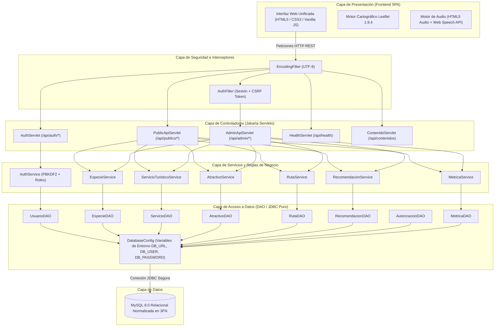

# Documento de Arquitectura de Software
## Sistema Integrado de Información Turística Comunitaria de Cotapata (COTAPATA EXPLORA)

---

## 1. Visión General de la Arquitectura

El sistema está diseñado bajo el patrón arquitectónico **Modelo-Vista-Controlador (MVC)** desacoplado, combinando una interfaz web rica responsiva (Single Page Application - SPA) con un backend robusto basado en **Java (Jakarta Servlets 5.0)** y persistencia relacional con **JDBC Puro sobre MySQL 8.0+**.

---

## 2. Principios de Diseño Arquitectónico

1. **Separación de Responsabilidades (SoC):** Cada capa posee una función exclusiva. Los servlets procesan la petición HTTP y envían JSON; los servicios validan reglas de negocio; los DAOs manejan SQL preparado; y la configuración gestiona conexiones.
2. **Cero ORM (JDBC Puro Estricto):** Todas las operaciones a la base de datos se efectúan mediante `PreparedStatement` y `ResultSet` dentro de bloques `try-with-resources`, garantizando un consumo mínimo de memoria RAM y máximo rendimiento en contenedores cloud.
3. **Seguridad Integral:**
   - **Contraseñas:** Derivación criptográfica mediante `PBKDF2WithHmacSHA256` con sal de 16 bytes y 65,536 iteraciones.
   - **CSRF:** Tokens criptográficos aleatorios vinculados a la sesión del servidor para operaciones mutantes (`POST`, `PUT`, `DELETE`).
   - **Inyección SQL:** Imposibilitada por el uso exclusivo de parámetros enlazados (`?`) en consultas preparadas.
   - **XSS:** Datos serializados mediante la librería estándar `org.json` y saneados antes de su renderizado.
4. **Resiliencia y Compatibilidad Retroactiva:** El endpoint `/api/contenidos` se conserva plenamente operativo para garantizar que cualquier componente cliente preexistente continúe funcionando sin interrupciones.

---

## 3. Estructura de Paquetes Java

- `bo.edu.usb.cotapata.config`: Configuración de base de datos y variables de entorno.
- `bo.edu.usb.cotapata.controller`: Servlets HTTP REST.
- `bo.edu.usb.cotapata.dao`: Clases de acceso a datos con JDBC puro.
- `bo.edu.usb.cotapata.filter`: Filtros de codificación de caracteres y autenticación.
- `bo.edu.usb.cotapata.model`: Clases entidad POJO con métodos de serialización JSON.
- `bo.edu.usb.cotapata.service`: Capa de lógica de negocio y validaciones.
- `bo.edu.usb.cotapata.util`: Criptografía PBKDF2, manejo seguro de JSON y tokens CSRF.
