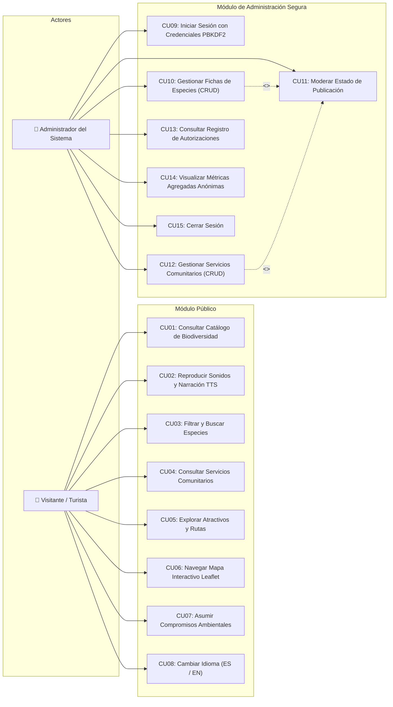

# Diagrama y Descripción de Casos de Uso
## Sistema Integrado de Información Turística Comunitaria de Cotapata (COTAPATA EXPLORA)
**Asignatura:** Análisis y Diseño de Sistemas

---

## 1. Diagrama de Casos de Uso del Sistema

---

## 2. Descripción Textual de Casos de Uso Principales

### CU01: Consultar Catálogo de Biodiversidad
- **Actor Principal:** Visitante.
- **Propósito:** Permitir al usuario explorar la riqueza biológica de Cotapata con nombres científicos y datos de conservación.
- **Precondiciones:** Acceso al navegador web con conexión al servidor.
- **Flujo Principal:**
  1. El visitante selecciona la sección "Biodiversidad".
  2. El sistema recupera vía AJAX las especies en estado "Validado".
  3. El sistema renderiza las tarjetas con imagen, nombre común, nombre científico y distintivos de conservación.
  4. El visitante pulsa sobre una tarjeta.
  5. El sistema despliega el modal interactivo con la ficha detallada y opciones sonoras.
  6. El sistema registra internamente una métrica anónima de consulta.

---

### CU02: Reproducir Sonidos de Fauna y Narración TTS
- **Actor Principal:** Visitante.
- **Propósito:** Ofrecer una experiencia sensorial y accesible mediante grabaciones reales y síntesis de voz.
- **Precondiciones:** La ficha de la especie debe encontrarse abierta en el modal.
- **Flujo Principal:**
  1. Si la especie es fauna y posee archivo de audio (.mp3), el visitante pulsa "🔊 Sonido Animal".
  2. El sistema reproduce la grabación sonora correspondiente.
  3. Si el visitante pulsa "🗣️ Narración Guiada", el sistema invoca la Web Speech API en el idioma activo (español o inglés).
  4. El visitante puede pausar o detener el audio en cualquier momento pulsando el botón de pausa.

---

### CU09: Iniciar Sesión Administrativa Segura
- **Actor Principal:** Administrador del Sistema.
- **Propósito:** Proteger las rutas y funciones de modificación de la plataforma.
- **Precondiciones:** El administrador debe poseer un usuario registrado en la base de datos MySQL.
- **Flujo Principal:**
  1. El usuario pulsa el botón "🔐 Admin" en el encabezado.
  2. El sistema despliega el formulario modal de ingreso de credenciales.
  3. El usuario ingresa su nombre de usuario y contraseña y envía el formulario.
  4. El servlet `AuthServlet` valida el hash criptográfico PBKDF2WithHmacSHA256 en la base de datos.
  5. Si es correcto, el servidor crea una sesión HTTP protegida, genera un token CSRF y responde exitosamente.
  6. El sistema abre el panel de control administrativo y actualiza el encabezado.
- **Flujo Alternativo:**
  - Si las credenciales no coinciden, el sistema retorna código HTTP 401 y muestra un mensaje de error sin revelar detalles internos.

---

### CU11: Moderar Estado de Publicación de Contenidos
- **Actor Principal:** Administrador del Sistema.
- **Propósito:** Garantizar que únicamente la información validada y autorizada sea visible al público general.
- **Precondiciones:** Sesión administrativa activa con token CSRF válido.
- **Flujo Principal:**
  1. El administrador ingresa a la pestaña correspondiente (Especies, Servicios, Atractivos o Rutas).
  2. En la columna de estado, selecciona una nueva opción del menú desplegable: `Validado`, `Pendiente`, `Borrador` o `Retirado`.
  3. El cliente JavaScript envía una solicitud POST a `/api/admin/{entidad}/estado` adjuntando el token en la cabecera `X-CSRF-Token`.
  4. El `AuthFilter` valida la sesión y el token; el servlet invoca al servicio correspondiente para actualizar el registro en MySQL.
  5. El cambio impacta inmediatamente: si se marca como `Retirado`, el recurso deja de ser visible en la vista pública.
