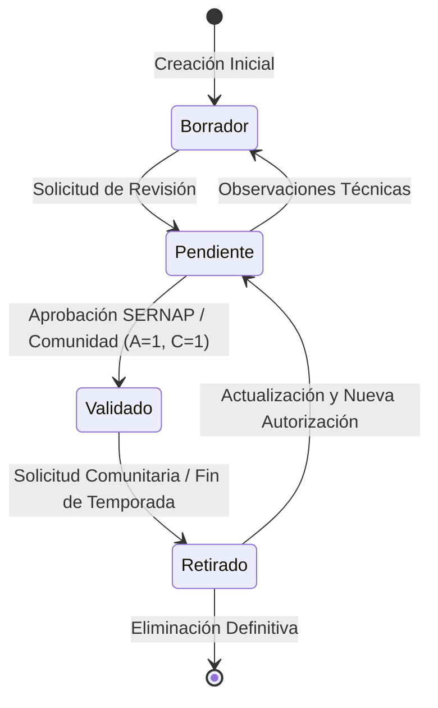

# Representación Digital y Flujos Lógicos de la Información
## Sistema Integrado de Información Turística Comunitaria de Cotapata (COTAPATA EXPLORA)
**Asignatura:** Sistemas Digitales I

---

## 1. Fundamento Académico: Procesamiento Digital de Información

En la asignatura **Sistemas Digitales I**, un sistema digital se conceptualiza como un conjunto de componentes interconectados que capturan variables de entrada discretas, aplican funciones de transferencia lógica basadas en álgebra de Boole o autómatas de estado finito, y generan señales de salida verificables.

En la plataforma **Cotapata Explora**, este principio se materializa en tres etapas fundamentales:

1. **Entradas Digitales (Inputs):** Solicitudes HTTP serializadas en tramas JSON, parámetros de consulta codificados en UTF-8, identificadores numéricos enteros y estados lógicos booleanos (`true`/`false`).
2. **Procesamiento Lógico (Transitions & States):**
   - Validación de estados de publicación mediante compuertas lógicas de decisión.
   - Verificación de igualdad en tiempo constante para hashes criptográficos.
   - Evaluación de la vigencia de autorizaciones comunitarias mediante lógica proposicional.
3. **Salidas Digitales (Outputs):** Respuestas HTTP formateadas con códigos de estado numéricos (200, 201, 401, 403, 404, 500) y estructuras de datos normalizadas enviadas al navegador.

---

## 2. Álgebra Booleana y Tablas de Verdad del Sistema

### 2.1. Condición Lógica de Visibilidad Pública de un Contenido ($V$)

Para que un recurso (especie, servicio, atractivo o ruta) sea transmitido en los endpoints públicos hacia los visitantes, deben cumplirse tres condiciones binarias indispensables:

- **$E$ (Estado Validado):** $1$ si `estado_validacion == 'Validado'`, $0$ en cualquier otro estado (`Pendiente`, `Borrador`, `Retirado`).
- **$A$ (Autorización Vigente):** $1$ si la autorización asociada en la base de datos tiene `vigente == TRUE`, $0$ si fue revocada o vencida.
- **$C$ (Consentimiento de la Comunidad):** $1$ si el prestador comunario autoriza la difusión pública (`autoriza_difusion == TRUE`), $0$ si retiró su consentimiento.

La función booleana de visibilidad pública se define formalmente como una conjunción lógica (Compuerta AND trivalente):

$$V = E \land A \land C$$

#### Tabla de Verdad de la Visibilidad Pública:

| Fila | $E$ (Validado) | $A$ (Autorización) | $C$ (Consentimiento) | Salida $V$ (Publicar en Web) | Acción del Sistema |
|:---:|:---:|:---:|:---:|:---:|---|
| 0 | 0 | 0 | 0 | **0** (Oculto) | Recurso retenido internamente |
| 1 | 0 | 0 | 1 | **0** (Oculto) | Recurso en borrador no aprobado |
| 2 | 0 | 1 | 0 | **0** (Oculto) | Falta consentimiento del comunario |
| 3 | 0 | 1 | 1 | **0** (Oculto) | Pendiente de revisión técnica |
| 4 | 1 | 0 | 0 | **0** (Oculto) | Autorización institucional revocada |
| 5 | 1 | 0 | 1 | **0** (Oculto) | Bloqueado por falta de convenio SERNAP |
| 6 | 1 | 1 | 0 | **0** (Oculto) | Comunario solicitó retiro voluntario |
| 7 | **1** | **1** | **1** | **1 (VISIBLE)** | **Se envía en el JSON de consulta pública** |

> **Conclusión Lógica:** Únicamente cuando las tres variables de entrada son verdaderas ($1$), la salida digital autoriza el despliegue del contenido al visitante. Cualquier perturbación o retiro de autorización conmuta la salida a $0$ de manera inmediata.

---

### 2.2. Condición Lógica de Autorización en Operaciones Mutantes ($M$)

Para que una solicitud de creación, actualización o cambio de estado sea procesada por el servlet administrativo, deben validarse:

- **$S$ (Sesión Activa):** $1$ si la sesión existe y contiene un objeto `Usuario` autenticado.
- **$T$ (Token CSRF Coincidente):** $1$ si `X-CSRF-Token` enviado coincide con el token en memoria de sesión.
- **$R$ (Rol Autorizado):** $1$ si el usuario posee rol `ADMINISTRADOR` o `GESTOR_COMUNITARIO`.

$$M = S \land T \land R$$

Si $M = 0$, el filtro interceptor aborta la ejecución y genera inmediatamente una respuesta de error HTTP 401 (No Autorizado) o HTTP 403 (Prohibido).

---

## 3. Diagrama de Flujo Lógico: Ciclo de Vida y Transición de Estados

Este modelo garantiza que ningún dato sea publicado sin trazabilidad y que cualquier comunario mantenga la potestad sobre sus datos en cualquier momento del ciclo de vida digital.
