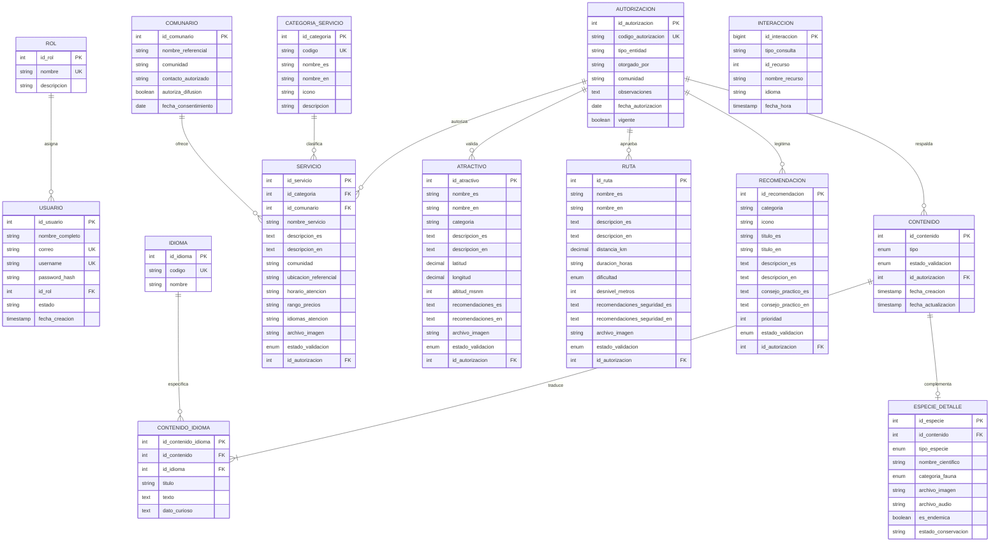

# Modelo Relacional y Diccionario de Datos
## Sistema Integrado de Información Turística Comunitaria de Cotapata (COTAPATA EXPLORA)
**Asignatura:** Análisis y Diseño de Sistemas

---

## 1. Diagrama Entidad-Relación (MER)

---

## 2. Normalización del Modelo a Tercera Forma Normal (3FN)

El diseño cumple estrictamente con las reglas de normalización relacional:

1. **Primera Forma Normal (1FN):**
   - Todos los atributos son atómicos; no existen listas ni grupos repetitivos incrustados dentro de columnas individuales (por ejemplo, los idiomas de traducción no se concatenan con separadores arbitrarios, sino que residen en la entidad débil `contenido_idioma`).
   - Cada tabla posee una clave primaria simple (`PRIMARY KEY`) unívoca.

2. **Segunda Forma Normal (2FN):**
   - Cumple la 1FN y cada atributo no clave depende funcionalmente de la totalidad de la clave primaria, eliminando dependencias parciales.
   - En `contenido_idioma`, la clave compuesta lógica `(id_contenido, id_idioma)` determina con precisión los textos traducidos para esa tupla específica.

3. **Tercera Forma Normal (3FN):**
   - Cumple la 2FN y no existen dependencias funcionales transitivas entre atributos que no sean clave.
   - La información de categorías (`categoria_servicio`), comunarios (`comunario`) y autorizaciones (`autorizacion`) se encuentra extraída a sus propias entidades independientes, evitando anomalías de inserción, actualización y borrado.

---

## 3. Diccionario de Datos Sintético

| Tabla | Clave Primaria | Claves Foráneas | Propósito en el Sistema |
|---|---|---|---|
| `usuario` | `id_usuario` | `id_rol` | Credenciales administrativas con hash PBKDF2 y roles de acceso. |
| `rol` | `id_rol` | Ninguna | Perfiles de usuario (ADMINISTRADOR, GESTOR_COMUNITARIO). |
| `idioma` | `id_idioma` | Ninguna | Catálogo de idiomas soportados (es: Español, en: English). |
| `autorizacion` | `id_autorizacion` | Ninguna | Registro documental de convenios y consentimientos informados. |
| `contenido` | `id_contenido` | `id_autorizacion` | Entidad base de contenidos (compatibilidad retroactiva con versión anterior). |
| `contenido_idioma` | `id_contenido_idioma` | `id_contenido`, `id_idioma` | Títulos y descripciones bilingües con datos curiosos. |
| `especie_detalle` | `id_especie` | `id_contenido` | Metadatos biológicos, endemismo, imágenes y audios (.mp3). |
| `categoria_servicio` | `id_categoria` | Ninguna | Tipología de servicios (alojamiento, alimentación, guiado, ecoturismo). |
| `comunario` | `id_comunario` | Ninguna | Datos de prestadores comunitarios con registro de consentimiento. |
| `servicio` | `id_servicio` | `id_categoria`, `id_comunario`, `id_autorizacion` | Oferta turística comunitaria verificada. |
| `atractivo` | `id_atractivo` | `id_autorizacion` | Sitios naturales, arqueológicos y miradores de Cotapata. |
| `ruta` | `id_ruta` | `id_autorizacion` | Senderos técnicos de trekking con especificaciones de seguridad. |
| `recomendacion` | `id_recomendacion` | `id_autorizacion` | Pautas de visita responsable (Código del Viajero). |
| `interaccion` | `id_interaccion` | Ninguna | Métricas agregadas de uso anónimo para evaluación del prototipo. |
